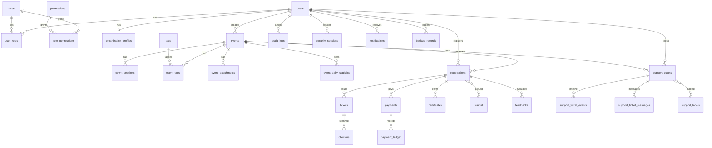

# DATABASE_CURRENT_ERD.md — نمودار ER موجود (مرحلهٔ ۵)

> از بازرسی `schema.sql` + `migrations/002_feature_set.sql` (۳۸ جدول).

## ۱. ERD مرکزی (رویداد / ثبت‌نام / مالی / حضور)

## ۲. جداول کلیدی و ستون‌های هسته (خلاصه)

| جدول | ستون‌های حیاتی |
|---|---|
| `events` | id, slug(U), title, delivery_mode, starts_at_utc, ends_at_utc, capacity, price_toman, tax_percent, tax_payer, poster_path, status, preview_token, created_by |
| `registrations` | id, event_id, user_id, status, **idempotency_key(U)**, amount_base/tax/total_toman, waitlist_position, organisation_completed |
| `tickets` | id, registration_id, **public_code(U)**, status, issued_by, revoked_at, reissued_from |
| `payments` | id, registration_id, event_id, user_id, provider, is_sandbox, status, *_toman, scenario, reference_code, paid_at, refunded_at — **U(registration_id, provider)** |
| `payment_ledger` | id, payment_id, event_id, entry_type, amount_toman, actor_id |
| `checkins` | id, ticket_id, checked_by, checked_at, source, **client_ref(U)**, synced_at |
| `certificates` | id, registration_id, **code(U)**, issued_by |
| `users` | id, phone(U), password_hash, account_type, status, session_version, two_factor_enabled |

## ۳. مسیرهای حذف (DELETE rules)

| رابطه | قانون |
|---|---|
| event حذف → created_by کاربر پاک نمی‌شود | کاربر حذف → رویدادهای `created_by` پاک می‌شوند (cascade در FK) |
| user حذف → payments.user_id `SET NULL` | بقیهٔ پرداخت‌ها حفظ می‌شوند |
| رکوردهای ثبت‌نام/پرداخت/بلیت | `RESTRICT` — حذف با دادهٔ وابسته ممکن نیست (درست) |

## ۴. نکات مشاهده‌شده برای طرح هدف

1. `waitlist` و `waitlist_position` هر دو → منبع حقیقت واحد شود.
2. `event_daily_statistics` فقط در 002 → در baseline هدف جای‌گیری کند.
3. `tickets` انتقال مالکیت ندارد → افزودن `transferred_to` در طرح هدف.
4. جدول‌های سازمانی/تخفیف/لاین/گردش‌کار/پیام/API → در ERD هدف.
