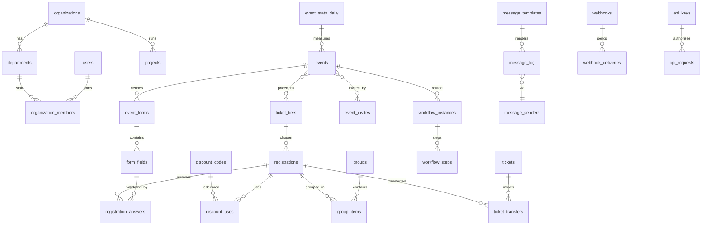

# DATABASE_TARGET_ERD.md — نمودار ER هدف + جریان‌های داده (مرحلهٔ ۵)

> قاعده: **فقط افزودن**؛ هیچ حذف/تغییر مخرب. اعداد نسخه‌ها در [DATABASE_MIGRATION_PLAN.md](DATABASE_MIGRATION_PLAN.md).

## ۱. ERD هدف (موجودیت‌های جدید با ● و موجود با ○)

## ۲. جدول‌های جدید پیشنهادی (نام + هدف + وابستگی)

| # | جدول جدید | هدف | افزودنی/نیاز |
|---|---|---|---|
| N1 | `organizations` | سازمان چندسطحی (مالک، حوزه، اندازه) | گسترش organization_profiles |
| N2 | `departments` | دپارتمان زیرمجموعه سازمان | افزودنی |
| N3 | `organization_members` | عضویت کاربر در سازمان/دپارتمان با نقش | افزودنی |
| N4 | `projects` | پروژه‌های سازمانی برای دسته‌بندی رویداد | افزودنی |
| N5 | `event_forms` + `N6 form_fields` | فرم سفارشی هر رویداد (نوع/الزام/ترتیب) | افزودنی |
| N7 | `registration_answers` | پاسخ‌های ثبت‌نام به فیلدهای سفارشی | افزودنی |
| N8 | `ticket_tiers` | لاین‌های بلیت (early-bird/VIP) با قیمت/سقف | افزودنی |
| N9 | `discount_codes` + `N10 discount_uses` | کد تخفیف + سهم استفاده | افزودنی |
| N11 | `event_invites` | دعوت‌نامهٔ رویداد خصوصی با توکن | افزودنی |
| N12 | `groups` + `N13 group_items` | ثبت‌نام گروهی | افزودنی |
| N14 | `workflow_instances` + `N15 workflow_steps` | گردش کار تأیید رویداد | افزودنی |
| N16 | `ticket_transfers` | انتقال بلیت/ثبت‌نام | افزودنی |
| N17 | `message_templates` + `N18 message_log` | قالب + لاگ تحویل پیام | افزودنی |
| N19 | `webhooks` + `N20 webhook_deliveries` | وب‌هوک خروجی/ورودی | افزودنی |
| N21 | `event_stats_daily` | آمار روزانه قابل بازیابی (در صورت لزوم) | افزودنی |
| N22 | `api_keys` + `N23 api_requests` | کلید API عمومی | افزودنی |
| N24 | `jobs` | صف کارهای زمان‌بندی‌شده (یادآوری/ارسال) | افزودنی |

## ۳. تغییرات ستونی جدول‌های موجود (بدون حذف)

| جدول | ستون جدید | هدف |
|---|---|---|
| `events` | `is_private`, `publish_at`, `close_at`, `template_of`, `workflow_state` | خصوصی/زمان‌بندی/قالب/گردش کار |
| `tickets` | `tier_id`, `transferred_to`, `transferred_at` | لاین/انتقال |
| `registrations` | `group_id`, `invited_by`, `discount_id` | گروه/دعوت/تخفیف |
| `payments` | `webhook_ref` | تطبیق وب‌هوک |

## ۴. جریان‌های داده (Registration / Payment / Attendance)

همان سه نمودار sequence در [TARGET_ARCHITECTURE.md §4](TARGET_ARCHITECTURE.md) آمده؛
خلاصهٔ جدولی تغییرات وضعیت:

| موجودیت | گذارهای مجاز هدف |
|---|---|
| ثبت‌نام | pending → paid → confirmed → attended / cancelled / refunded / waitlisted / rejected |
| پرداخت | pending → paid / failed / expired → refunded → reconciled |
| بلیت | issued → used(checked) / revoked / transferred / reissued |
| رویداد | draft → in_review → approved → published → completed / archived / cancelled |

## ۵. ایندکس‌های هدف (طرح پیشنهادی)

- `registrations(event_id, status)` [اگر ناقص باشد — D4]، `registrations(group_id)`
- `ticket_tiers(event_id, status)`، `discount_codes(code)` UNIQUE
- `event_stats_daily(event_id, day)` UNIQUE
- `message_log(entity_type, entity_id, status)`، `webhook_deliveries(webhook_id, status, created_at)`
- `workflow_instances(entity_type, entity_id, state)`
