# IMPLEMENTATION_ROADMAP.md — نقشهٔ راه اجرای ۱۱ فاز (مرحلهٔ ۱۳)

> وضعیت: **پیش‌نویس برای تأیید — اجرا نشده** (approval_policy مرحلهٔ ۱۳).
> هر فاز با دروازهٔ (Gate) پایان می‌یابد: دروازه سبز = گزارش واقعی + تأیید کارفرما قبلی حفظ شده.

## نمودار وابستگی فازها

```mermaid
graph LR
    A[F0 ممیزی] --> B[F1 معماری هسته]
    B --> C[F2 فرم/گروه/خصوصی/زمان‌بندی]
    C --> D[F3 گردش کار + لاین/تخفیف]
    D --> E[F4 سازمان چندسطحی]
    E --> F[F5 یکپارچگی: درگاه واقعی/وب‌هوک/پیام]
    F --> G[F6 تحلیل/گزارش]
    G --> H[F7 API عمومی]
    H --> I[F8 پرداخت تجاری]
    I --> J[F9 امنیت نهایی]
    J --> K[F10 QA و عملیات]
    K --> L[F11 انتشار نسخه ۲.۰]
```

## فازها با جزئیات

| فاز | محتوا (بر اساس FEATURE_GAP_ANALYSIS) | خروجی قابل سنجش | تخمین* |
|---|---|---|---|
| **F0 ممیزی** ✅ انجام شده | این ۱۵ سند؛ بدون تغییر کد/DB | docs/audit/* + تأیید کارفرما | — |
| **F1 معماری هسته** | لایه Application سبک، استخراج Header/Csrf، Core(Money/Clock/Id)، requirePermission (default-deny) | هر ۴۹۷ تست قبلی سبز + ۲۰ تست مجوز جدید | ۱–۲ هفته |
| **F2 ثبت‌نام پیشرفته** | فرم سفارشی (N5–N7)، گروهی (N12–N13)، خصوصی+دعوت (N11, is_private)، زمان‌بندی انتشار (publish_at/close_at)، تکثیر رویداد | ۵ قابلیت P0 با تست رد/قبول | ۲–۳ هفته |
| **F3 بلیت/قیمت/گردش کار** | لاین بلیت (N8)، تخفیف (N9–N10)، انتقال بلیت (N16)، موتور گردش کار (N14–N15) | محاسبهٔ قیمت/مالیات چندلاینی سبز؛ تأیید چندمرحله‌ای با audit | ۲ هفته |
| **F4 سازمان** | organizations/departments/members/projects + مهاجرت داده | گزارش تفکیکی سازمانی؛ عضویت نقش‌محور | ۲ هفته |
| **F5 یکپارچگی پایه** | Port پرداخت + آداپتر واقعی + وب‌هوک ورودی امضاشده (N19–N20)، MessageSender + قالب/لاگ (N17–N18) | پرداخت sandbox→gateway-adapter در تست mock؛ لاگ تحویل | ۲–۳ هفته |
| **F6 تحلیل** | event_stats_daily + داشبورد + نرخ حضور | نمودارهای واقعی از دادهٔ تست | ۱ هفته |
| **F7 API** | /api/v1 + کلید (N22–N23) + وب‌هوک خروجی + مستندات | مجموعه تست API در دروازه | ۱–۲ هفته |
| **F8 پرداخت تجاری** | اتصال درگاه + reconcile + تسویه | سناریوی پرداخت واقعی E2E در محیط تست درگاه | ۲ هفته (وابسته به اخذ درگاه) |
| **F9 امنیت نهایی** | CSP بدون unsafe-inline (S3)، HSTS (S4)، رمزنگاری PII (S6)، لاگ ساختاریافته (S8)، S1/S2 تکمیل | گزارش امنیتی + چک‌لیست انتشار به‌روز | ۱ هفته |
| **F10 QA و عملیات** | بستن ۱۳ `[~]`، ماتریس مرورگر، تست‌های همزمانی/پرداخت/QR (Q4)، بکاپ زمان‌بندی | دروازهٔ کامل ۰ شکست + گزارش دسترس‌پذیری | ۲ هفته |
| **F11 انتشار ۲.۰** | نسخهٔ ZIP جدید، مستندات کاربری، گزارش تحویل | لینک دانلود تأییدشده + اعلام رسمی | ۳ روز |

*تخمین‌ها برای یک توسعه‌دهندهٔ آشنا با مخزن است؛ در F10 همهٔ معیارهای پذیرش §های ۱–۱۲ FEATURE_GAP باید «سبز» شده باشند.

## دروازه‌های تأیید (Approval Gates)

| گیت | چه چیزی باید تأیید شود |
|---|---|
| **G0** | همین امروز: تأیید شروع F1 (نمی‌شود بدون تأیید شروع کرد) |
| G1 | پایان F1: ۴۹۷ تست سبز + ۲۰ تست مجوز جدید |
| G2 | پایان F2: دموی فرم سفارشی/گروهی/خصوصی |
| G3 | پایان F3: دموی لاین/تخفیف/گردش کار |
| G4 | پایان F5: پرداخت با آداپتر mock و وب‌هوک امضاشده |
| G5 | پایان F8: گزارش پرداخت واقعی |
| G6 | پایان F10: دروازهٔ کامل ۰ شکست |
| **G7** | انتشار نسخهٔ ۲.۰ |

## قواعد اجرایی (از سند اصلی — لازم‌الاجرا)

1. حفظ منطق کسب‌وکار، دیتابیس، رفتار قابل مشاهده — مگر با تأیید صریح
2. بدون جایگزینی تکنولوژی / بدون بازنویسی
3. بدون عملکرد غیرواقعی یا پیام موفقیت جعلی — فقط چیزی که تست شده
4. هر فاز: کد + تست + داکیومنت همراه
5. مهاجرت DB: پشتیبان + تأیید (DATABASE_MIGRATION_PLAN)
6. هیچ تغییری قبل از G0

## اجرای پیشنهادی بلافاصله پس از G0

**F1 (شامل requirePermission + استخراج لایه‌های سبک)** چون:
- S2 (بزرگ‌ترین یافتهٔ امنیتی) را می‌بندد
- بقیهٔ فازها روی ساختار تمیز سوار می‌شوند
- هیچ رفتار بیرونی را تغییر نمی‌دهد (۴۹۷ تست باید بی‌تغییر سبز بمانند)
