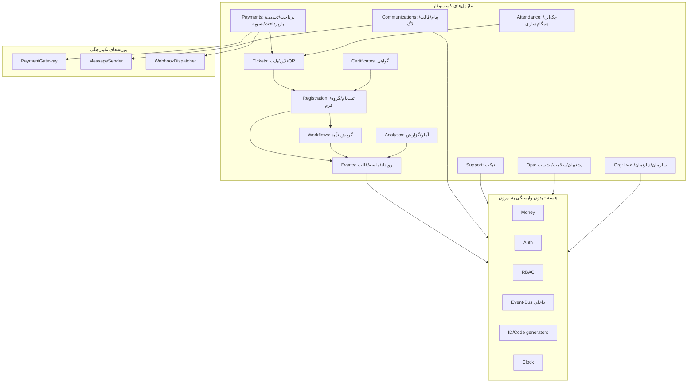
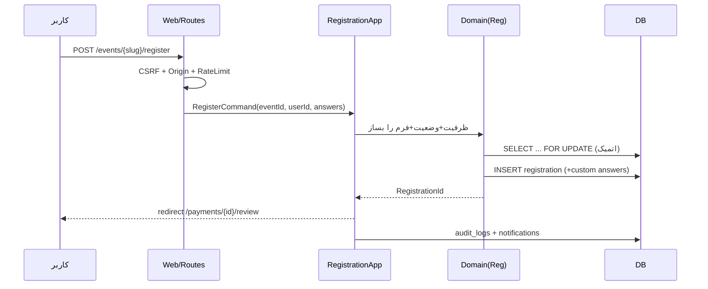
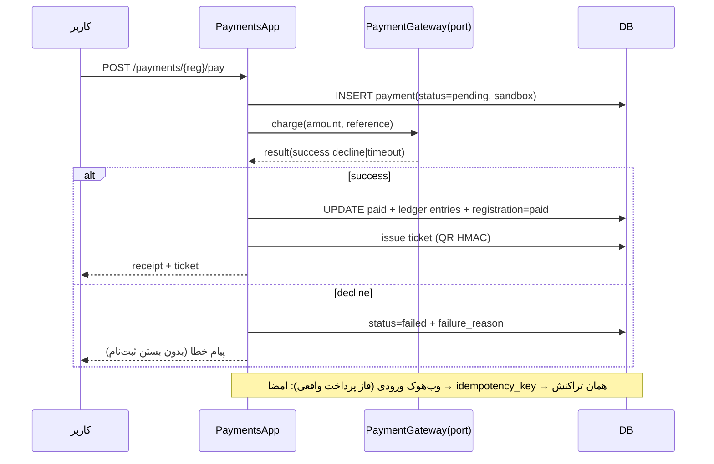
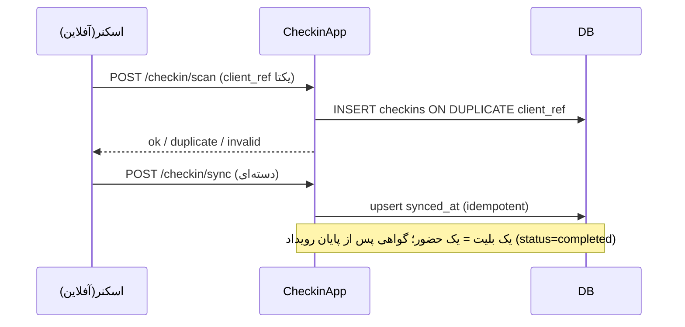

# TARGET_ARCHITECTURE.md — معماری هدف (مرحلهٔ ۳)

> قاعدهٔ الزامی: **بدون جایگزینی تکنولوژی، بدون بازنویسی** — همان پشتهٔ واقعی
> **PHP 7.4 + PDO/MySQL + Vanilla JS/HTML/CSS + XAMPP** باقی می‌ماند؛
> چیزی که اضافه می‌شود **ساختار** (Monolith ماژولار + Clean Architecture) است، نه زبان/فریمورک جدید.

## ۱. اصل طراحی

```
┌────────────────────────────────────────────────────────────┐
│                     Monolith واحد (یک استقرار)              │
│  ┌──────────┐  ┌──────────────┐  ┌───────────────────────┐ │
│  │  HTTP     │→│ Application  │→│  Domain (Core)         │ │
│  │ (routes + │  │ (Use-Cases,  │  │  Entities + Rules     │ │
│  │  present)│  │  DTO, guards)│  │  (Enterprise Rules)   │ │
│  └──────────┘  └──────┬───────┘  └───────────▲───────────┘ │
│                       │                      │             │
│                 ┌─────▼──────────────────────┴──────┐      │
│                 │ Infrastructure (PDO, Mail, Gate…)  │      │
│                 │  پورت‌ها/آداپترها قابل تعویض       │      │
│                 └───────────────────────────────────┘      │
└────────────────────────────────────────────────────────────┘
```

- **Clean Architecture در مقیاس کوچک:** هر ماژول پوشه‌های `Domain/`, `Application/`, `Infrastructure/` دارد؛
  وابستگی فقط به داخل (Dependencies Inversion با interface سبک PHP 7.4).
- **بدون تغییر رفتار بیرونی:** URLها، قالب‌ها، دیتابیس، مجوزها حفظ می‌شوند؛ مهاجرت‌ها افزایشی.

## ۲. نمودار وابستگی ماژول‌ها (Module Dependency Diagram)



**قواعد:** ماژول‌های لبه (Support, Analytics) فقط با Core و رویدادهای داخلی حرف می‌زنند؛
کسی به جز Core به `Money/Clock` دست نمی‌زند؛ عبور از مرز فقط با DTO ساده.

## ۳. نقشهٔ پوشهٔ هدف (بدون حذف فایل‌های موجود)

```
backend/
├── bootstrap.php              (کاهش‌یافته: فقط سیم‌کشی)
├── routes/                    (فقط delegate به Application)
├── src/
│   ├── Core/                  ← جدید: Money, Clock, Id, EventBus
│   ├── Security/              (حفظ + استخراج HeaderService/Csrf)
│   ├── Auth/  Org/  Events/  Registration/  Tickets/  Payments/
│   ├── Attendance/  Certificates/  Workflows/  Communications/
│   ├── Analytics/  Support/  Ops/  Reports/  Excel/  Media/
│   └── *​/Domain|Application|Infrastructure   (ساختار داخلی هر ماژول)
└── ...
```

## ۴. سه جریان دادهٔ حیاتی (Data Flow)

### ۴.۱ ثبت‌نام (Registration Flow)



### ۴.۲ پرداخت (Payment Flow)



### ۴.۳ حضور/چک‌این (Attendance Flow)



## ۵. تصمیم‌های کلیدی معماری هدف

| تصمیم | انتخاب | چرا |
|---|---|---|
| الگو | **Modular Monolith** (نه میکروسرویس) | استقرار XAMPP تک‌پرونده‌ای حفظ می‌شود |
| پشته | همان PHP 7.4 / بدون framework | architectural_rule: بدون بازنویسی |
| API | `/api/v1` همان monolith با کلید | بدون سرویس جدید |
| کار پس‌زمینه | اسکریپت cron PHP + جدول jobs | بدون Redis/Queue خارجی |
| پیام | Port `MessageSender` با آداپتر محلی/SMTP/SMS | در نسخهٔ محلی mock، در واقعی واقعی |
| گردش کار | موتور state-machine سبک (جدول workflow_instances) | قابل تست بدون کتابخانه خارجی |
| چند-tenant سطحی | ستون org_id + فیلتر در Data-Access لایه | مهاجرت افزایشی، بدون شاردینگ |

## ۶. چه چیزی تغییر **نمی‌کند**

- هیچ تغییری در رمزگذاری/الگوری فعلی پول، QR، CSRF، نشست، مجوزها بدون تست
- هیچ حذف جدول/ستون در مهاجرت‌ها (فقط افزودن/سازگاری)
- هیچ جایگزینی کتابخانه/فریمورک — ابزار تست همان WASM می‌ماند
